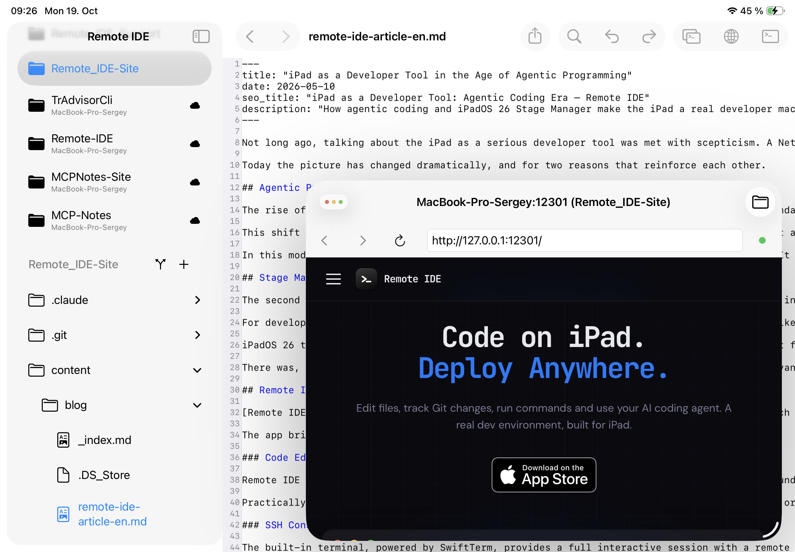

Web development runs on constant feedback: write - check the browser - fix. On iPad that loop was always the weakest link: you could edit code, but seeing how it actually looked in a browser while you worked, without a gap between terminal, editor, and a separate app, almost never happened. Below is a workflow where that gap is closed: the dev server runs on a remote physical or virtual host, an AI agent (Claude Code) writes and fixes the code in place, and [Remote IDE](https://remote-ide.com) shows the live result in a built-in browser right next to the editor, the terminal, and the Git diff - all on an iPad with Stage Manager.

<cut />

## Why this works at all

A web project is, at its core, a process listening on a port: `hugo server`, `npm run dev`, `python manage.py runserver` - whatever the stack. If that process is running on a server your iPad has SSH access to, the only thing missing for real development is a way to open `127.0.0.1:<port>` of that server in a browser right from the iPad, instead of just logs in a terminal. That's exactly what Remote IDE does: the dev server's port is attached to the project, and the built-in browser opens it as if it were running locally on the device.

From there it works like regular desktop development: the agent changes a file, the dev server for Hugo or any other framework rebuilds it on the fly, and the updated page is one window switch away - no deploying to a host just to check one paragraph.

## Step one: the dev server port in the project settings

A remote project in Remote IDE has a port field alongside the server path and the **"Use remote filesystem"** toggle. That's the port your dev server listens on - `12301` for this Hugo site, `8080` for the Python project next to it, `12302` for a third one. Set it once in the project settings and you never have to think about it again - the app already knows which port to open for that project's preview.

## Step two: the agent starts the server, the editor sits alongside

From there it's the usual AI agent workflow in the terminal. You ask it to start the dev server - Claude Code runs `hugo server` (or `npm run dev`, depending on the project), reports that the server is listening on the right port and reloads on changes to files, templates, or styles. Next to it, an editor window with the project file open, showing the full source rather than just what the agent typed into the chat.

## Step three: a built-in browser instead of deploying to a host

This is the real difference from "regular" iPad development. Open a third window - Remote IDE's built-in browser - point it at `127.0.0.1:12301`, and you see the exact site the dev server on that remote host just built, with the window titled `MacBook-Pro-Sergey:12301 (Remote_IDE-Site)`, clearly tied to the server, the port, and the project. No deploy just to check one edit, no "I'll look later at my Mac" - the result is visible right away, while the agent, or you, are still editing.

In practice there's rarely just one project in flight at a time. The preview window switcher lists every open "server : port" pair: `Remote_IDE-Site :12301`, `TrAdvisorCli :8080`, `MCPNotes-Site :12302` - three different projects on the same host, each on its own port, and switching between their live previews is one tap, not retyping an address or hunting for which terminal belongs to which site.

## MCP Notes integration

A lot of project detail doesn't live in the code: an SEO requirements checklist, a list of known issues, agreements with a client. Keeping that in your head, or retyping it to the agent in chat every time, is awkward. [MCP Notes](https://mcp-notes.com) solves it differently: plain Markdown notes synced over iCloud between Mac, iPad, and iPhone, and at the same time available to any MCP-compatible AI agent through a built-in MCP server with semantic search (RAG) - no cloud database, no accounts.

Notes get edited right on the iPad, in the MCP Notes app, between tasks in Remote IDE. And when the agent in the terminal gets a task like "check the SEO requirements for this project," nobody needs to paste the checklist into the chat by hand - it reaches into MCP Notes itself, finds the right note by semantic search even if its exact title was never mentioned in the request, and checks against it.

In the example below the agent reached into MCP Notes, found the "SEO checklist detailed EN" note, then built the site and used `curl` to check the actually served HTML at the live address - and only after that reported that almost everything passed, apart from a couple of items.

## Git diffs next to the live result

Once the agent has fixed something, the natural next step is to see exactly what changed without leaving the preview. The Git status window shows the list of changed files (in this case `index.md`, `baseof.html`, `netlify.toml`), a line-by-line diff with additions highlighted in green and deletions in red - and right there, in a floating window on top, the live site that diff affected. You see the code and the result at the same time, without having to hold in your head what was supposed to change.

## Takeaway

Web development has long been the genre that stalled hardest on iPad - precisely because of the gap between "wrote the code" and "saw the result in a browser." A dev server port attached to the project, a built-in browser that opens it as a local address, a switcher between several projects running at once, and Git diffs sitting right next to the live preview close that gap: the agent writes and fixes code on the remote server, and the "write - look - fix" loop stays entirely on the iPad, with no detour just to check something in a browser.

Remote IDE - to discuss a feature, suggest an idea, or report a problem, head to [GitHub Issues](https://github.com/sergeydi/Remote-IDE_Support/).

---

[Download Remote IDE on the App Store →](https://apps.apple.com/app/remote-ide/id6762590018)

---

**Tags:** web development, iPadOS, Hugo, SSH, AI, agentic programming, Git, Stage Manager
