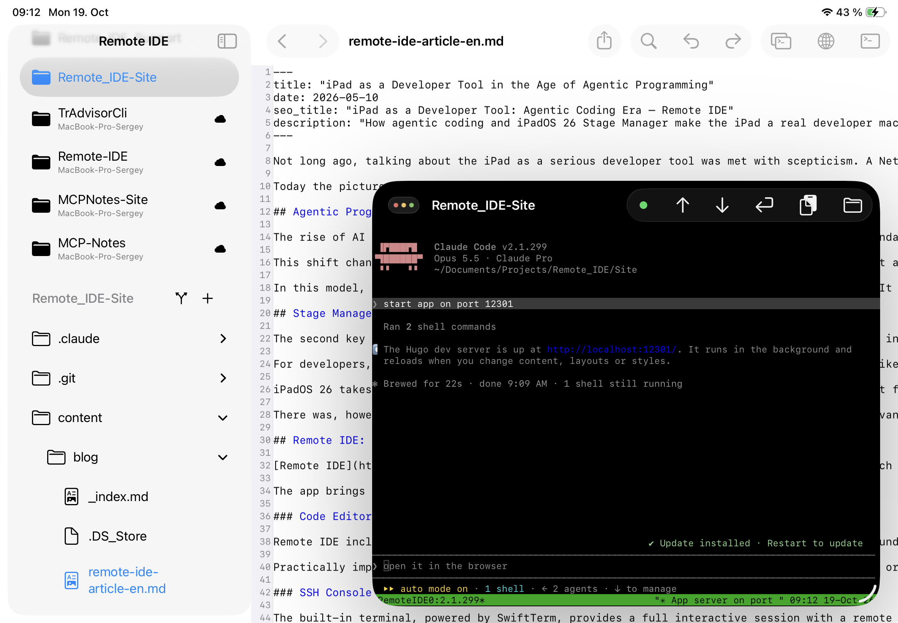
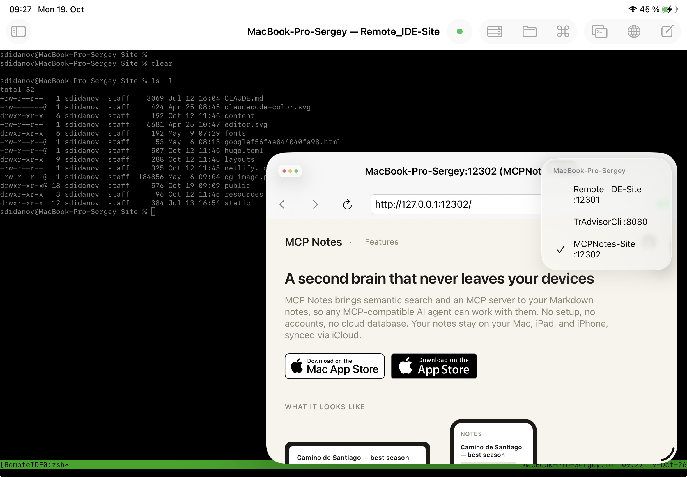

Веб-разработка требует постоянной обратной связи: написал - посмотрел в браузере - поправил. На iPad это всегда было самым слабым звеном: код можно было редактировать, но увидеть, как он выглядит в браузере именно в процессе работы, без разрыва между терминалом, редактором и отдельным приложением - почти никогда. Ниже - рабочий процесс, в котором эта проблема снята: dev-сервер крутится на удалённом физическом или виртуальном хосте, AI-агент (Claude Code) пишет код и правит его по месту, а [Remote IDE](https://remote-ide.com) показывает живой результат во встроенном браузере рядом с редактором, терминалом и Git-диффом - на iPad со Stage Manager.

<cut />

## Почему это вообще работает

Веб-проект - это, по сути, процесс, слушающий порт: `hugo server`, `npm run dev`, `python manage.py runserver` - неважно, какой стек. Если этот процесс запущен на сервере, к которому у iPad есть SSH-доступ, то единственное, чего не хватает для полноценной разработки - это способ открыть `127.0.0.1:<порт>` этого сервера в браузере прямо с iPad, а не только логи в терминале. Remote IDE умеет именно это: порт dev-сервера привязывается к проекту, и встроенный браузер открывает его так, будто он работает локально на устройстве.

Дальше всё как в обычной десктопной разработке: агент меняет файл, dev-сервер Hugo или любого другого фреймворка пересобирает его на лету, а обновлённая страница - на расстоянии одного переключения окна, без выгрузки на хостинг ради того, чтобы проверить один абзац.

## Шаг первый: порт dev-сервера в настройках проекта

У удалённого проекта в Remote IDE, кроме пути на сервере и переключателя **«Use remote filesystem»**, есть поле для порта. Это тот самый порт, на котором слушает ваш dev-сервер - `12301` у этого сайта на Hugo, `8080` у соседнего Python-проекта, `12302` у третьего. Указав его один раз в настройках проекта, дальше не нужно ничего вспоминать - приложение знает, какой порт открывать для предпросмотра именно этого проекта.

## Шаг второй: агент поднимает сервер, редактор рядом

Дальше - обычный рабочий цикл с AI-агентом в терминале. Просишь поднять dev-сервер - Claude Code выполняет `hugo server` (или `npm run dev`, в зависимости от проекта), сообщает, что сервер слушает на нужном порту и перезагружается при изменении файлов, шаблонов или стилей. Рядом - окно редактора с открытым файлом проекта, в котором видно исходники целиком, а не только то, что агент написал в чате.

## Шаг третий: встроенный браузер вместо выгрузки на хостинг

Это и есть главное отличие от «обычной» разработки на iPad. Открываешь третье окно - встроенный браузер Remote IDE, указываешь `127.0.0.1:12301` - и видишь тот самый сайт, который только что собрал dev-сервер на удалённом физическом или виртуальном хосте, с заголовком окна `MacBook-Pro-Sergey:12301 (Remote_IDE-Site)`, явно привязанным к серверу, порту и проекту. Никакого деплоя ради проверки одной правки, никакого «посмотрю вечером за Mac» - результат виден сразу, пока агент или вы сами ещё в процессе редактирования.

На практике параллельно в работе не один проект. У переключателя окон предпросмотра есть список всех открытых пар «сервер : порт»: `Remote_IDE-Site :12301`, `TrAdvisorCli :8080`, `MCPNotes-Site :12302` - три разных проекта на одной машине, каждый на своём порту, и переключение между их живыми предпросмотрами - это один тап, а не повторный ввод адреса или поиск, какой терминал к какому сайту относится.

## Интеграция с MCP Notes

Многие детали проекта живут не в коде: чек-лист SEO-требований, список известных проблем, договорённости с заказчиком. Держать это в голове или пересказывать агенту в чате вручную при каждом запуске - неудобно. [MCP Notes](https://mcp-notes.com) решает это иначе: обычные Markdown-заметки синхронизируются через iCloud между Mac, iPad и iPhone и при этом доступны любому MCP-совместимому AI-агенту через встроённый MCP-сервер с семантическим поиском (RAG) - без облачной базы и аккаунтов.

Заметки правятся прямо на iPad, в приложении MCP Notes, в перерывах между задачами в Remote IDE. А когда агент в терминале получает задачу вроде «проверь SEO-требования для проекта», ему не нужно, чтобы кто-то скопировал чек-лист в чат руками - он сам обращается к MCP Notes, семантическим поиском находит нужную заметку, даже если её точное название не упомянуто в запросе, и сверяется уже с ней.

В примере ниже агент обратился к MCP Notes, нашёл чек-лист «SEO checklist detailed EN», затем собрал сайт и запросом `curl` проверил уже реально отданный HTML на боевом адресе - и только после этого отчитался, что почти всё в порядке, кроме пары пунктов.

## Git-диффы рядом с живым результатом

После того как агент что-то поправил, естественный следующий шаг - посмотреть, что именно изменилось, не отходя от предпросмотра. Окно Git-статуса показывает список изменённых файлов (в этом случае - `index.md`, `baseof.html`, `netlify.toml`), построчный диф с подсветкой добавленного зелёным и удалённого красным - и тут же, во всплывающем окне поверх, тот самый живой сайт, на который этот диф повлиял. Видно и код, и результат одновременно, без необходимости держать в голове, что именно должно было поменяться.

## Итог

Веб-разработка долго была тем жанром, который на iPad буксовал сильнее остальных - именно из-за разрыва между «написал код» и «увидел результат в браузере». Порт dev-сервера, привязанный к проекту, встроенный браузер, который открывает его как локальный адрес, переключатель между несколькими одновременно запущенными проектами и Git-диффы рядом с живым предпросмотром закрывают этот разрыв: агент пишет и чинит код на удалённом сервере, а цикл «написал - посмотрел - поправил» остаётся на iPad целиком, без захода на сторону ради одной проверки в браузере.

Remote IDE - обсудить функциональность, предложить идею или сообщить о проблеме можно в [GitHub Issues](https://github.com/sergeydi/Remote-IDE_Support/).

---

[Загрузить Remote IDE в App Store →](https://apps.apple.com/app/remote-ide/id6762590018)

---

**Теги:** веб-разработка, iPadOS, Hugo, SSH, AI, агентное программирование, Git, Stage Manager
