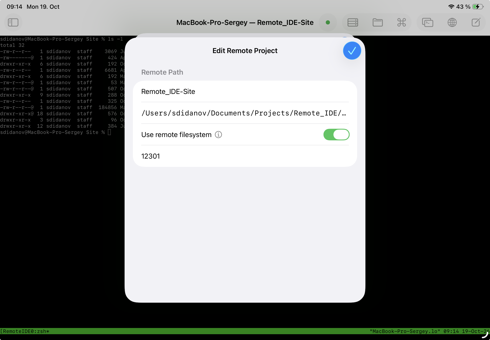
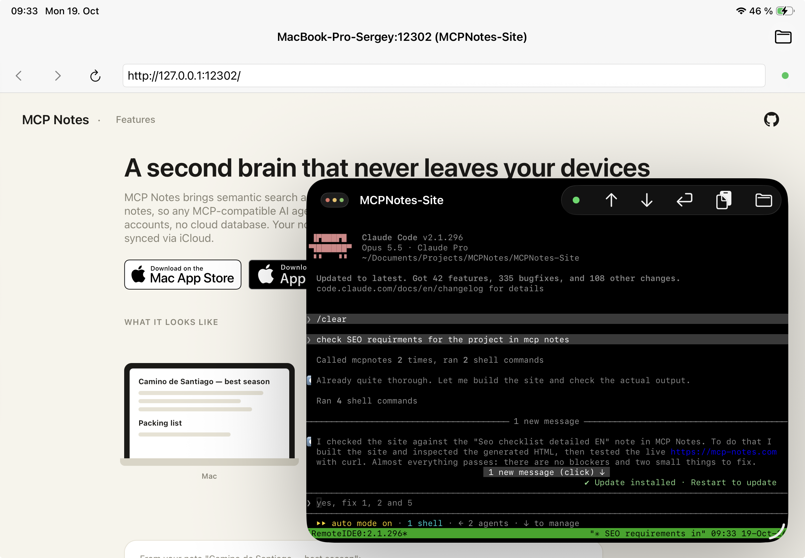
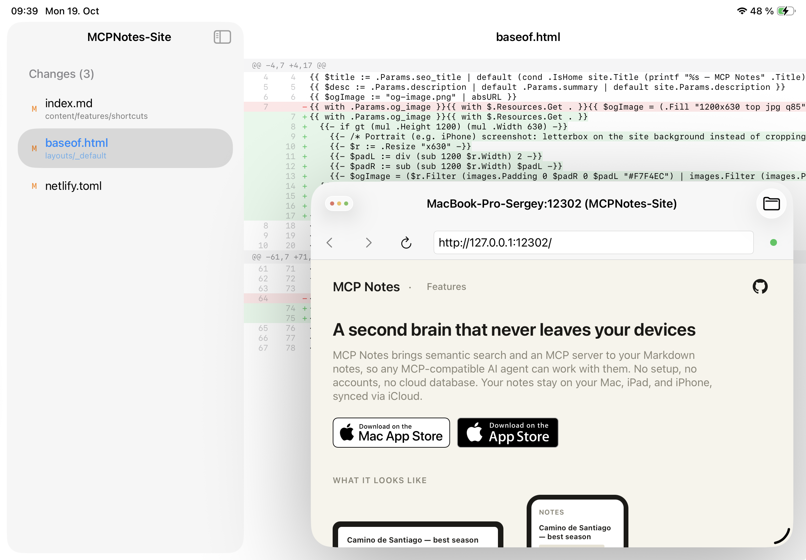

Веброзробка потребує постійного зворотного зв'язку: написав - подивився в браузері - виправив. На iPad це завжди було найслабшою ланкою: код можна було редагувати, але побачити, як він виглядає в браузері саме в процесі роботи, без розриву між терміналом, редактором і окремим застосунком - майже ніколи. Нижче - робочий процес, у якому цю проблему знято: dev-сервер працює на віддаленому фізичному або віртуальному хості, AI-агент (Claude Code) пише код і виправляє його на місці, а [Remote IDE](https://remote-ide.com) показує живий результат у вбудованому браузері поруч із редактором, терміналом і Git-дифом - на iPad зі Stage Manager.

<cut />

## Чому це взагалі працює

Веб-проєкт - це, по суті, процес, що слухає порт: `hugo server`, `npm run dev`, `python manage.py runserver` - неважливо, який стек. Якщо цей процес запущено на сервері, до якого iPad має SSH-доступ, то єдине, чого бракує для повноцінної розробки - це спосіб відкрити `127.0.0.1:<порт>` цього сервера в браузері прямо з iPad, а не лише логи в терміналі. Remote IDE вміє саме це: порт dev-сервера прив'язується до проєкту, і вбудований браузер відкриває його так, ніби він працює локально на пристрої.

Далі все як у звичайній десктопній розробці: агент змінює файл, dev-сервер Hugo чи будь-якого іншого фреймворку перезбирає його на льоту, а оновлена сторінка - на відстані одного перемикання вікна, без вивантаження на хостинг заради перевірки одного абзацу.

## Крок перший: порт dev-сервера в налаштуваннях проєкту

У віддаленого проєкту в Remote IDE, крім шляху на сервері та перемикача **«Use remote filesystem»**, є поле для порту. Це той самий порт, на якому слухає ваш dev-сервер - `12301` у цього сайту на Hugo, `8080` у сусіднього Python-проєкту, `12302` у третього. Вказавши його один раз у налаштуваннях проєкту, далі не треба нічого пригадувати - застосунок знає, який порт відкривати для перегляду саме цього проєкту.

## Крок другий: агент піднімає сервер, редактор поруч

Далі - звичайний робочий цикл з AI-агентом у терміналі. Просиш підняти dev-сервер - Claude Code виконує `hugo server` (або `npm run dev`, залежно від проєкту), повідомляє, що сервер слухає на потрібному порту й перезавантажується при зміні файлів, шаблонів чи стилів. Поруч - вікно редактора з відкритим файлом проєкту, в якому видно вихідний код цілком, а не лише те, що агент написав у чаті.

## Крок третій: вбудований браузер замість вивантаження на хостинг

Це і є головна відмінність від «звичайної» розробки на iPad. Відкриваєш третє вікно - вбудований браузер Remote IDE, вказуєш `127.0.0.1:12301` - і бачиш той самий сайт, який щойно зібрав dev-сервер на віддаленому фізичному або віртуальному хості, із заголовком вікна `MacBook-Pro-Sergey:12301 (Remote_IDE-Site)`, явно прив'язаним до сервера, порту й проєкту. Жодного деплою заради перевірки однієї правки, жодного «подивлюся ввечері за Mac» - результат видно одразу, поки агент чи ви самі ще в процесі редагування.

На практиці паралельно в роботі не один проєкт. У перемикача вікон перегляду є список усіх відкритих пар «сервер : порт»: `Remote_IDE-Site :12301`, `TrAdvisorCli :8080`, `MCPNotes-Site :12302` - три різні проєкти на одному хості, кожен на своєму порту, і перемикання між їхніми живими переглядами - це один тап, а не повторне введення адреси чи пошук, який термінал до якого сайту належить.

## Інтеграція з MCP Notes

Багато деталей проєкту живуть не в коді: чек-лист SEO-вимог, список відомих проблем, домовленості із замовником. Тримати це в голові або переказувати агенту в чаті вручну щоразу - незручно. [MCP Notes](https://mcp-notes.com) вирішує це інакше: звичайні Markdown-нотатки синхронізуються через iCloud між Mac, iPad та iPhone і водночас доступні будь-якому MCP-сумісному AI-агенту через вбудований MCP-сервер із семантичним пошуком (RAG) - без хмарної бази та акаунтів.

Нотатки редагуються прямо на iPad, у застосунку MCP Notes, у перервах між задачами в Remote IDE. А коли агент у терміналі отримує задачу на кшталт «перевір SEO-вимоги для проєкту», йому не потрібно, щоб хтось скопіював чек-лист у чат вручну - він сам звертається до MCP Notes, семантичним пошуком знаходить потрібну нотатку, навіть якщо її точну назву не згадано в запиті, і звіряється вже з нею.

У прикладі нижче агент звернувся до MCP Notes, знайшов чек-лист «SEO checklist detailed EN», потім зібрав сайт і запитом `curl` перевірив уже реально відданий HTML на бойовій адресі - і лише після цього відзвітував, що майже все гаразд, окрім пари пунктів.

## Git-дифи поруч із живим результатом

Після того як агент щось виправив, природний наступний крок - подивитися, що саме змінилося, не відходячи від перегляду. Вікно Git-статусу показує список змінених файлів (у цьому випадку - `index.md`, `baseof.html`, `netlify.toml`), порядковий диф із підсвічуванням доданого зеленим і видаленого червоним - і тут же, у спливаючому вікні поверх, той самий живий сайт, на який цей диф вплинув. Видно і код, і результат одночасно, без потреби тримати в голові, що саме мало змінитися.

## Підсумок

Веброзробка довго була тим жанром, який на iPad буксував найсильніше - саме через розрив між «написав код» і «побачив результат у браузері». Порт dev-сервера, прив'язаний до проєкту, вбудований браузер, що відкриває його як локальну адресу, перемикач між кількома одночасно запущеними проєктами і Git-дифи поруч із живим переглядом закривають цей розрив: агент пише й виправляє код на віддаленому сервері, а цикл «написав - подивився - виправив» лишається на iPad цілком, без заходу вбік заради однієї перевірки в браузері.

Remote IDE - обговорити функціональність, запропонувати ідею чи повідомити про проблему можна в [GitHub Issues](https://github.com/sergeydi/Remote-IDE_Support/).

---

[Завантажити Remote IDE в App Store →](https://apps.apple.com/app/remote-ide/id6762590018)

---

**Теги:** веброзробка, iPadOS, Hugo, SSH, AI, агентне програмування, Git, Stage Manager
